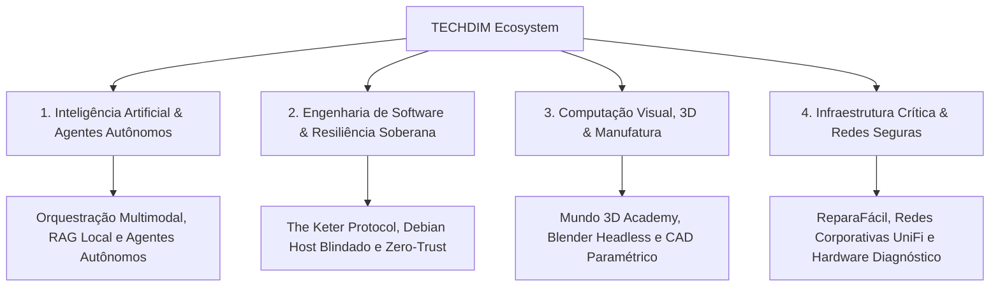

# 🏛️ TECHDIM INOVA SIMPLES (I.S.) — ME
### *Engenharia de Software Soberana, Inteligência Artificial Multimodal & Computação Visual 3D*

---

> *"A convergência entre sabedoria analítica, estratégia soberana e engenharia de sistemas modernos."*

---

## 🧭 Sobre a TECHDIM

A **TECHDIM** é uma organização de inovação e engenharia tecnológica sediada em **Campinas — SP**, estruturada sob princípios de soberania digital, arquiteturas *Zero-Trust*, resiliência de sistemas distribuídos e inteligência artificial aplicada. 

Nossa atuação integra o ciclo completo de tecnologia: da pesquisa conceitual e governança de software à implantação de plataformas corporativas, estúdios de manufatura aditiva 3D e infraestrutura crítica.

---

## ⚡ Nossos 4 Pilares de Engenharia

### 1. 🤖 Inteligência Artificial Agêntica & RAG Soberano
- Desenvolvimento de enxames de subagentes autônomos para engenharia, pesquisa contínua e automação de operações.
- Arquiteturas RAG (*Retrieval-Augmented Generation*) locais com vetorização semântica, soberania de dados e privacidade total.
- Pipelines multimodais integrando LLMs de última geração, síntese de voz, visão computacional e geração generativa em alta escala.

### 2. 🏛️ The Keter Protocol & Engenharia Soberana
- Arquitetura de software desenhada para alta disponibilidade, isolamento criptográfico e tolerância extrema a falhas.
- Cultura técnica orientada a *Post-Mortem sem Culpa* (*Blameless*), observabilidade contínua e cadeia imutável de confiança.
- Automação via Debian Linux Host Soberano (KVM, Podman Rootless e segredos injetados via cofre criptográfico em memória).

### 3. 🎨 Computação Visual, 3D & Manufatura Digital
- Plataforma e ecossistema de capacitação **Mundo 3D Academy**.
- Pipelines automatizados de renderização e modelagem headless com **Blender (BMesh)** e exportação paramétrica.
- Fatiamento automatizado e calibração de perfis industriais para impressão 3D (Bambu Lab, Creality e OrcaSlicer).

### 4. 🛠️ Soluções Corporativas, Hardware & ReparaFácil
- Operação e suporte avançado de TI, diagnóstico preditivo de componentes eletrônicos e reparo de precisão via **ReparaFácil**.
- Governança de redes corporativas de alta performance (UniFi Enterprise, UDM Sentinel e segregação de VLANs de segurança).

---

## 🌐 Portais Oficiais do Ecossistema

| Iniciativa / Produto | Propósito & Âmbito | Acesso |
| :--- | :--- | :---: |
| **Portal Corporativo TECHDIM** | Portal institucional oficial e catálogo de soluções de TI | [techdim.com.br](https://techdim.com.br) |
| **The Keter Protocol** | Acervo de estudos, manifesto de engenharia e resiliência | [keter-protocol](https://techdimbr.github.io/the-keter-protocol/) |
| **ReparaFácil Informática** | Assistência especializada, manutenção de hardware e redes | [reparafacil](https://techdimbr.github.io/reparafacil/) |
| **Mundo 3D Academy** | Treinamentos de modelagem 3D, IA e impressão profissional | [mundo3d](https://techdimbr.github.io/MUNDO3D/) |
| **Portal Executivo do Diretor** | Biografia de engenharia, credenciais e artigos técnicos | [deivis-mayer](https://techdimbr.github.io/deivis-mayer/) |

---

## 🛠️ Stack Tecnológica & Padrões

| Categoria | Tecnologias Principais |
| :--- | :--- |
| **Linguagens & Runtimes** | Python 3.12+, TypeScript, Node.js, Bash Seguro (`set -euo pipefail`), Go, C++ |
| **IA & Multimodalidade** | Google Gemini API, Claude API, Embeddings Locais, Visão Computacional, PyTorch |
| **Sistemas Operacionais & Infra** | Debian 13 (Trixie/Sid), KVM/QEMU, Podman, UniFi OS, Google Cloud Platform (GCP) |
| **3D & Mídia Digital** | Blender Headless, BMesh Scripting, Python CAD, FFmpeg, ImageMagick |
| **Segurança & Governança** | KeePassXC CLI, Zero-Trust Architecture, ISO/IEC 29147, LGPD/GDPR, GitHub Rulesets |

---

## 🛡️ Segurança e Divulgação Responsável

A TECHDIM adota o padrão internacional **ISO/IEC 29147** para divulgação responsável de vulnerabilidades.  
Se você identificar qualquer oportunidade de melhoria de segurança em nossos repositórios públicos, consulte nossa política oficial em [SECURITY.md](https://github.com/Techdim/.github/blob/main/SECURITY.md) antes de qualquer divulgação.

---

### 🤝 Conecte-se com a Engenharia TECHDIM

**Direção Técnica:** Eng. Deivis Irio Mayer  
📍 **Sede:** Campinas — SP, Brasil  
✉️ **Contato Institucional:** [contato@techdim.com.br](mailto:contato@techdim.com.br) • [reparafacilcampinas@gmail.com](mailto:reparafacilcampinas@gmail.com)  

© TECHDIM INOVA SIMPLES (I.S.) — ME. Todos os direitos reservados. Conhecimento, Poder e Equilíbrio.

